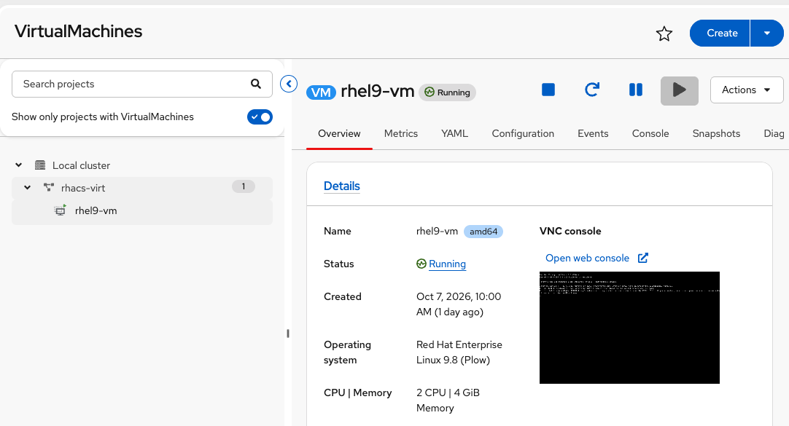

= Scope, Defaults, and the HyperConverged Object
:role: Virtualization Security Foundations
:skills: OpenShift Virtualization, HyperConverged, Hardening Scope
:labid: LAB-VIRT-00
:toc:
:toclevels: 1
:icons: font

**Duration:** ~15 minutes

== Overview
Red Hat OpenShift Virtualization is an extension on top of an already-hardened OpenShift cluster. The link:https://access.redhat.com/sites/default/files/attachments/rh-openshift-virtualization-hardening-guide-detail-202512-en.pdf[Red Hat OpenShift Virtualization hardening guide^] is focused on hardening the hypervisor and not how to STIG the OS inside the VM.

This module confirms *Container-Native Virtualization* (CNV) is installed, shows the one object you will audit for the rest of the pathway (`HyperConverged/kubevirt-hyperconverged` in `openshift-cnv`), and orients you to the running `rhel9-vm` VM. Later modules do not reinstall anything; they read and, only when a control has already drifted, remediate.

== Why it matters
A VM traditionally looks like a pet server. On OpenShift it isn't. It is a handful of custom resources (VirtualMachine, DataVolume, NAD) plus privileged node components (virt-handler, virt-launcher) that actually run the guest.

Harden only the guest and you miss device passthrough, live-migration RBAC, and KubeVirt feature gates. Harden only OpenShift and the hypervisor is still an attack surface. You have to treat both.

== What are we trying to solve

* Treating CNV as "just another operator" with no extra baseline
* Performing only guest-only hardening.
* Confusing Kata sandboxed pods (xref:201-09-sandboxed-containers-intro.adoc[201-09]) with full VMs on OpenShift Virtualization

== Your Mission
Prove CNV is healthy, name the HyperConverged object you will audit from virt-01 onward, and confirm the lab VM is Running. 

=== Prerequisites

* Cluster-admin (or permission to get CRs in `openshift-cnv` and VMs in `rhacs-virt`)
* OpenShift Virtualization installed (this environment already has it)
* OpenShift console tab available from the xref:index.adoc[home page]

Click each step for the full solution.

.Confirm the OpenShift Virtualization CSV
[%collapsible]
====
You want a Succeeded ClusterServiceVersion in `openshift-cnv`. If this is empty, stop: the rest of the pathway cannot run.

[source,bash,subs="+macros,+attributes",role=execute]
----
oc get csv -n openshift-cnv
----

TIP: Look for a CSV whose name includes `kubevirt-hyperconverged` (or similar) with phase `Succeeded`.
====

.Get the HyperConverged object
[%collapsible]
====
Almost every platform control in this pathway is a field on this single namespaced CR. Operators reconcile from HCO; do not jsonpatch the downstream KubeVirt/CDI objects yourself (virt-01 covers that annotation).

[source,bash,subs="+macros,+attributes",role=execute]
----
oc get hyperconverged kubevirt-hyperconverged -n openshift-cnv
oc get hyperconvergeds.v1beta1.hco.kubevirt.io kubevirt-hyperconverged -n openshift-cnv -o json | jq '.spec.featureGates // {}'
----

*console output:*
```
NAME                      AGE
kubevirt-hyperconverged   34h
{
  "alignCPUs": false,
  "containerPathVolumes": false,
  "decentralizedLiveMigration": true,
  "declarativeHotplugVolumes": false,
  "deployKubeSecondaryDNS": false,
  "disableMDevConfiguration": false,
  "downwardMetrics": false,
  "enableMultiArchBootImageImport": false,
  "incrementalBackup": false,
  "objectGraph": false,
  "persistentReservation": false,
  "videoConfig": true
}
```

====

.Read the feature gates
[%collapsible]
====
The map above is `spec.featureGates` on this cluster. Two gates are on: `decentralizedLiveMigration` and `videoConfig`. The rest are off.

`alignCPUs` (`false`)::
When a VM pins the QEMU emulator thread to its own dedicated CPU, KubeVirt can request up to two extra dedicated CPUs so the total is even. With this off, KubeVirt leaves the CPU count as requested.

`containerPathVolumes` (`false`)::
Lets a VM mount a path from the virt-launcher pod through virtiofs, including files Kubernetes injected into the pod, such as a projected service-account token. With this off, the guest stays on its own disks.

`decentralizedLiveMigration` (`true`)::
Live migration can move a running VM between namespaces and between clusters, using separate source and target migration objects. This gate is on by default and widens who can relocate a VM.

`declarativeHotplugVolumes` (`false`)::
Volume hotplug uses KubeVirt's subresource API. A disk change written into the VirtualMachine spec takes effect on the next restart. With this on, that same spec edit hotplugs or unplugs the volume immediately.

`deployKubeSecondaryDNS` (`false`)::
Deploys KubeSecondaryDNS so guests on secondary networks can resolve DNS. With this off, that component stays undeployed.

`disableMDevConfiguration` (`false`)::
KubeVirt still configures mediated devices such as a vGPU slice. Setting this to `true` stops that handling.

`downwardMetrics` (`false`)::
Exposes a small set of host and VM CPU and memory metrics into the guest over a virtio-serial port. With this off, the guest receives none of those host metrics. virt-01 expects `false`.

`enableMultiArchBootImageImport` (`false`)::
Lets the operator build golden boot images for each CPU architecture on a mixed-architecture cluster. Off matches this single-architecture lab.

`incrementalBackup` (`false`)::
Turns on QEMU changed-block tracking for incremental VM backups, and utility volumes on the launcher pod to hold backup data. With this off, that backup path stays unavailable.

`objectGraph` (`false`)::
Serves a subresource that lists the Kubernetes objects related to a VirtualMachine or VirtualMachineInstance. With this off, that inventory API stays unavailable. The guest is unchanged.

`persistentReservation` (`false`)::
Lets a guest issue SCSI Persistent Reserve commands against a shared LUN, and adds a `qemu-pr-helper` container to virt-handler. virt-01 expects `false`.

`videoConfig` (`true`)::
A VM spec can set the video device under `spec.template.spec.domain.devices.video` (`virtio`, `vga`, `bochs`, `cirrus`, or `ramfb`). If that field is unset, KubeVirt still picks the architecture default.
====

.Confirm the rhel9-vm VM
[%collapsible]
====
This VM is the production-like audit target for virt-04 and virt-05. Do not delete it and do not patch its spec in this pathway.

[source,bash,subs="+macros,+attributes",role=execute]
----
oc get vm,vmi -n rhacs-virt
oc get vm rhel9-vm -n rhacs-virt -o jsonpath='{.status.printableStatus}{"\n"}'
----

TIP: `VirtualMachine` and `VirtualMachineInstance` exist. Status should be `Running`.
====

.Open VirtualMachines in the console
[%collapsible]
====
In the OpenShift console: *Virtualization* → *VirtualMachines*. Enable *Show only projects with VirtualMachines* and select project `rhacs-virt`. Overview should show one Running VM with guest agent reporting.



TIP: Zero alerts and one Running VM is a clean baseline before you start scoring controls.
====

.Know what this guide does not cover
[%collapsible]
====
Keep these boundaries in mind for every later module:

* *Guest OS separately.* RHEL, Windows, or other guests follow their own hardening guides.
* *Level 1 vs Level 2.* Level 1 is the expected baseline. Level 2 (KSM, dedicated VLANs, MultiNetworkPolicy) is extra segmentation or anti-side-channel posture.
* *Defaults are often already hardened.* Many audits should return empty or `false`. That is a pass, not a skipped lab.
* *Kata containers vs CNV.* xref:201-09-sandboxed-containers-intro.adoc[201-09] isolates a *pod* with a second kernel. This pathway hardens *virtual machines* scheduled by KubeVirt.

====

== Debrief

HyperConverged/kubevirt-hyperconverged is the control plane for OpenShift Virtualization. The HyperConverged Cluster Operator owns the KubeVirt, CDI, and related operands and reconciles them to match this CR. Feature gates, insecure registries, and most of the cluster-wide virt posture live here, or get applied here as jsonpatch annotations that HCO forwards.

VirtualMachine/rhel9-vm is the workload. It is the guest you can log into, plus the spec that asks for disks, networks, and devices. Hardening the pathway means both: the cluster object that decides what KubeVirt is allowed to do, and the VM object that decides what this guest is allowed to ask for.

Hardening only the guest leaves the interesting surface outside it. Device passthrough, live-migration RBAC, and KubeVirt feature gates are not RHEL settings. A locked-down rhel9-vm on a permissive HCO is still a hypervisor with extra hardware and a migration API.

== Cleanup

Run the cleanup script after every module. It does not delete HCO or `rhel9-vm`.

:lab-cleanup-module: virt-00
include::partial$lab-cleanup.adoc[]
